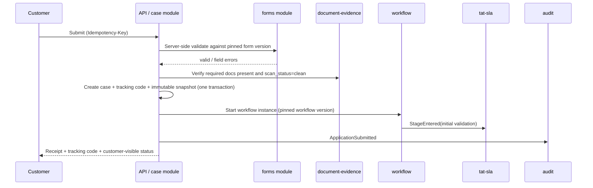

# 01 — Architecture

[SOURCE: §15, §22.1] Items marked `[PROPOSED]` are recommendations; see ADRs in `16`.

## 1. Logical layers

```mermaid
flowchart TB
  subgraph EXP[Experience layer]
    CP[Customer portal - responsive web / deep link / embed]
    SP[Staff operations portal]
    AP[Admin and management portal]
    BA[Branch-assisted interface - optional]
  end
  subgraph IAM[Identity and access]
    CI[Customer identity and profile]
    SSO[Bank SSO / staff IdP]
    OTP[OTP / MFA provider]
    AC[RBAC + ABAC, consent, sessions]
  end
  subgraph JW[Journey and workflow]
    CAT[Service catalogue]
    FRM[Form schema + renderer]
    CASE[Case management]
    WF[Workflow engine]
    APR[Approval + delegation]
    TAT[SLA / TAT event service]
    COM[Communication centre]
    APPT[Appointment / visit]
  end
  subgraph DOM[Domain services]
    DOC[Document intake + evidence]
    KYC[KYC / identity orchestration]
    CRD[Credit proposal + checklist]
    SCR[Scorecard config + calculation]
    TRD[Trade finance requests]
    DEP[Deposit / account requests]
    SIG[Signature orchestration]
    NOT[Notifications]
    RPT[Reporting + analytics]
  end
  subgraph INT[Integration layer]
    GW[API gateway]
    CON[Connector / adapter framework]
    BUS[Queue / event bus + outbox]
    FILE[Scheduled file exchange - pilot]
    DLQ[Retry, DLQ, reconciliation]
  end
  subgraph DATA[Data layer]
    RDB[(Relational DB)]
    OBJ[(Encrypted object storage)]
    AUD[(Append-only audit / event store)]
    DWH[(Reporting mart)]
    IDX[(Permission-aware search)]
    CFG[(Versioned configuration store)]
  end
  subgraph OPS[Security and operations]
    SIEM[Central logs / SIEM]
    MON[Metrics + alerting]
    BKP[Backup + DR]
    KMS[Secrets + keys]
    CICD[Pipelines + env separation]
  end
  EXP --> IAM --> JW --> DOM --> INT --> EXT[(CBS, LMS, DMS, card, trade, payment, AML, signature provider)]
  JW --> DATA
  DOM --> DATA
  OPS -.-> EXP
  OPS -.-> JW
  OPS -.-> INT
```

## 2. System-of-record ownership (decide before implementing)

| Information / function | Authoritative system |
|---|---|
| Customer, account balances, core account status | CBS |
| Loan facility, repayment, servicing | LMS/CBS or bank-designated |
| Authoritative document archive | Existing DMS / bank repository |
| Card production and activation | Card management system |
| Trade instrument issuance/settlement | Trade finance system |
| Payment execution | Authorised payment/core system |
| Identity and screening results | Bank-approved KYC/AML/screening systems |
| Application journey and customer-submitted draft | **BBJP** until handed off or synchronised per policy |
| Workflow task state and stage timestamps | **BBJP**, with integration events recorded |
| Ledger entries | General ledger / core |
| Digital-signature certificate and verification evidence | Approved provider + retained evidence |

**Rule:** BBJP stores only what it needs. It does not duplicate balances, credentials or full card details. (PRV-04)

## 3. Modular monolith — modules and boundaries `[PROPOSED]`

Start as one deployable with strict internal module boundaries (ADR-002). Split a module out only when there is measured evidence (scaling, team, isolation, or regulatory need).

| Module | Owns | Publishes events (examples) |
|---|---|---|
| `identity-access` | Users, roles, ABAC policies, sessions, delegation, authority matrix | `UserRoleChanged`, `DelegationGranted` |
| `customer-profile` | Profile, contacts, verification status, org relationships | `ProfileCreated`, `ContactVerified`, `CustomerLinked` |
| `consent` | Notice versions, consent records | `ConsentRecorded` |
| `service-catalogue` | Service definitions/versions, visit triggers, remote class | `ServicePublished` |
| `forms` | Form definitions/versions, validation, drafts | `DraftSaved` |
| `case` | Case, participants, snapshots, tracking code, related cases | `ApplicationSubmitted`, `CaseClosed` |
| `workflow` | Definitions/versions, instances, tasks, queues, escalation | `StageEntered`, `StageExited` |
| `approval` | Approvals, decisions, authority check, conditions | `ApprovalRequested`, `DecisionRecorded` |
| `document-evidence` | Requirements, files, versions, scan, review, hash | `DocumentUploaded`, `DocumentReviewCompleted` |
| `info-request` | Return-to-customer loop | `CustomerInformationRequested`, `CustomerResponseReceived` |
| `kyc-orchestration` | Calls to approved identity/screening providers; results as references | `KycResultReceived` |
| `credit-workspace` | Proposals, checklists, exposure snapshots, conditions | `RecommendationSubmitted` |
| `scorecard` | Scorecard definitions/versions, deterministic calculation, overrides | `ScoreCalculated` |
| `collateral` | Collateral, valuation, margin calc, pledge status refs | `MarginCallRaised` |
| `trade-finance` | Trade requests, document schedule, discrepancy loop | `DiscrepancyRaised` |
| `signature` | Signature requests and evidence via provider | `SignatureCompleted` |
| `appointment` | Visit scheduling, originals checklist, completion | `VisitRequired`, `VisitCompleted` |
| `notification` | Templates, delivery (no sensitive content), communication centre | `NotificationSent` |
| `tat-sla` | SLA policies, calendars, TAT events, derived facts | (consumes all stage/wait events) |
| `reporting` | Read models, dashboards, metric dictionary | — |
| `integration-gateway` | Connectors, outbox, retries, DLQ, reconciliation | `IntegrationRequested/Confirmed/Failed` |
| `audit` | Audit/access/config-change events | — |
| `configuration` | Versioned config store, maker-checker, publish/rollback | `ConfigPublished`, `ConfigRolledBack` |
| `ai-assist` (Phase 10) | Extraction, summaries, human corrections, model logs | `AiExtractionCompleted` |

**Boundary rules**

1. A module may read another module's data **only** through its public interface or by consuming its events.
2. No cross-module table joins in application code. Reporting uses read models/mart.
3. State transitions on a case happen **only** via `workflow` (WFL-04).
4. Every module writes audit events through the `audit` interface.
5. Enforce with architecture tests (dependency rules) in CI.

## 4. Core request flows

### 4.1 Submission

Repeat of the same Idempotency-Key returns the original result and creates no duplicate case.

### 4.2 Document upload

Client requests an upload slot → uploads to private storage via short-lived signed target or through the API → validates type/size/**file signature** → hash computed → malware scan (status `pending`) → staff can only open after `clean` → versioned record linked to requirement → audit. Replacement creates version N+1; N is retained.

### 4.3 Integration hand-off (outbox)

Decision recorded → `integration_request` row written **in the same transaction** as the state change (outbox) → dispatcher sends with idempotency key and correlation ID → authoritative system returns confirmation → only then `IntegrationConfirmed` → workflow moves to *fulfilled*. Timeout/ambiguous → status `ambiguous`, visible to ops, resolved by query/reconciliation, never blind re-send. See `09`.

## 5. Integration maturity levels

| Level | Mechanism |
|---|---|
| **Pilot** | Controlled, encrypted file import/export, schema validation, reconciliation |
| **Standard** | REST APIs, SFTP, webhooks, scheduled sync |
| **Enterprise** | Event-driven integration, service bus, bank API gateway, SSO, real-time status sync, idempotent callbacks |

## 6. Tenancy and deployment

- **Dedicated single-bank deployment** supported first. Shared multi-tenant SaaS is *not* the default for sensitive bank data; tenant isolation, residency, regulatory approval and security design must be assessed first. `[BANK-DECIDES]`
- Cloud, private cloud or bank-controlled hosting only where the team's operational capability and bank requirements support it.
- Environments: development, test/UAT, staging, production — strictly separated; synthetic or masked data outside production.
- Schema and config migrations version-controlled and reversible where feasible.
- Design all tables with `institution_id` even when running single-tenant so the model does not need rework.

## 7. Cross-cutting design

| Concern | Design |
|---|---|
| Authorisation | RBAC + ABAC (branch, department, portfolio, product, legal entity, sensitivity, amount, assignment). Central policy decision point; object-level checks on every read/write. |
| Audit | Append-only, hash-chained audit events; separate access-event stream for views/downloads. |
| Configuration | Versioned, immutable once published; effective dates; cases pin versions. |
| Events | Domain events with correlation IDs; no personal/account data in names or public IDs. |
| Time | UTC storage; business calendars per bank; source-system timestamps and clock quality preserved. |
| i18n | Locale-aware content in the data model; Nepali and English minimum. |
| Search | Permission-aware retrieval only (index never returns what the user cannot open). |
| Resilience | Graceful degradation when providers fail: retry queues, manual fallback, ops alerts. |
| Secrets/keys | Central secrets manager and KMS; rotation; no credentials in source. |
| Observability | Structured logs with redaction, metrics, traces with correlation IDs, SIEM export. |

## 8. Technology choices `[PROPOSED — see ADR-016/018]`

The source report does not mandate a stack. Recommended selection criteria: mature, widely supported, strong security track record, available talent, and ability to be hosted on bank-controlled infrastructure.

| Area | Recommendation to evaluate |
|---|---|
| Backend | One mainstream typed language/framework with strong DI and testing (e.g. Java/Kotlin + Spring, or TypeScript + NestJS, or C#/.NET) |
| Database | PostgreSQL (relational, JSONB for versioned schemas, row-level security option) |
| Object storage | S3-compatible, private, server-side encryption, object lock for evidence where appropriate |
| Messaging | Start with DB outbox + a mature broker (e.g. RabbitMQ/Kafka) when needed |
| Workflow | Evaluate a mature embeddable engine vs. a purpose-built state machine over a versioned graph (ADR-018) |
| Identity | Mature IdP supporting OIDC/SAML/MFA; bank SSO integration |
| Frontend | Responsive web app, component library with accessibility built in, PWA-capable for camera/low bandwidth |
| Search | Permission-aware index (e.g. OpenSearch/Postgres FTS) |
| Analytics | Read-optimised mart; warehouse only when volume justifies |
| Infra | Containers + IaC; separate environments; SIEM integration |

Do not build custom cryptography. Do not build liveness/face matching. Use mature workflow, identity and document components where possible after security/licence review. `[SOURCE: §22.1]`
