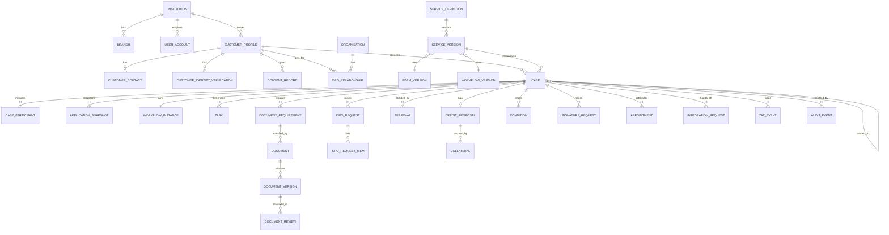

# 02 — Data Model

[SOURCE: §16] Field lists are a **starting contract**, to be refined in migrations and the API spec. Sensitive data must be minimised and segmented.

## 1. Conventions

| Convention | Rule |
|---|---|
| Keys | Opaque UUIDs (`id`). Public locators (tracking code) are random, non-sequential, non-informative, unique. |
| Tenancy | Every business table has `institution_id`. Repositories are tenant-scoped. |
| Time | `timestamptz` in UTC. Store `source_system_ts` and `clock_quality` where imported. |
| Versioning | Config entities use `*_definition` + `*_version`. Versions have `status` (draft/in_review/published/retired), `effective_from`, `retire_at`, content `hash`. Published versions are immutable. |
| Immutability | Append-only: `audit_event`, `access_event`, `config_change_event`, `tat_event`, `application_snapshot`, `document_version`, `consent_record`, `score_result`, `approval`, `signature_evidence`. No UPDATE/DELETE path; DB role has INSERT/SELECT only. |
| Deletion | No hard delete of evidence. Retention rules and legal holds drive controlled disposition; every disposition recorded in `deletion_record`. |
| Sensitive fields | Each field has a privacy classification (`public`, `internal`, `personal`, `sensitive`, `restricted`). `sensitive`/`restricted` encrypted at field level where required. |
| Localisation | User-facing text stored as locale maps (`{en, ne}`) in config tables. |
| Audit columns | `created_at`, `created_by`, and for mutable rows `updated_at`, `updated_by`, `row_version` (optimistic locking). |

## 2. Entity-relationship overview

## 3. Entity catalogue

### 3.1 Organisation and access

| Entity | Key attributes |
|---|---|
| `institution` | code, name, jurisdiction, default_locale, timezone, feature flags, data-residency profile |
| `branch` / `department` / `portfolio` | institution_id, code, name, region, parent, active |
| `user_account` (staff) | directory_subject (from bank IdP), status, mfa_level, manager_id, last_login |
| `role` / `permission` | name, description, risk_tier (high-risk roles need second approver) |
| `user_role_assignment` | user_id, role_id, scope attributes (branch/department/portfolio/product), valid_from/to, approved_by |
| `delegation` | from_user, to_user, scope, limit, valid_from, valid_to, approved_by, revoked_at |
| `authority_matrix_entry` | role/user, service_type, proposal_type, amount_min/max, currency, version, effective_from |
| `emergency_access_grant` | user, justification, approver, expires_at, reviewed_by, reviewed_at |

### 3.2 Customer, identity, consent

| Entity | Key attributes |
|---|---|
| `customer_profile` | status, completion_state, core_customer_ref (nullable until linked), link_method, linked_at, locale |
| `customer_contact` | channel (email/mobile), value (encrypted) + lookup hash, verified_at, is_primary, change history |
| `customer_identity_verification` | method, provider_ref, result, assurance_level, evidence_ref, performed_at, expires_at, performed_by |
| `customer_field_value` | profile_id, field_key, value (encrypted), verification_status (verified/unverified), source, source_date, confirmed_at |
| `organisation` | legal_name, registration_no, status, registration evidence ref |
| `org_relationship` | org_id, profile_id, role (director, BO, signatory, representative…), authority_evidence_doc_id, verified_by, verified_at, valid_to |
| `consent_notice_version` | purpose, type (required/marketing), language, body_hash, effective_from |
| `consent_record` | profile_id, notice_version_id, granted, timestamp, session_id, device/session metadata |

### 3.3 Configuration (versioned)

| Entity | Key attributes |
|---|---|
| `service_definition` / `service_version` | key, remote_class (remote / remote_first_conditional / attendance_required), visit_triggers, required_auth_level, channels, languages, branch/region/currency applicability, owner_dept, effective_from, retire_at, form_version_id, workflow_version_id, terms_version_id, customer help content |
| `form_definition` / `form_version` | field schema (typed fields, validation, conditional logic, privacy class, repeatable sections, calculated fields with formula + version), status, hash |
| `workflow_definition` / `workflow_version` | graph (nodes, edges, guards, SLA timers, status mapping, assignment rules), status, hash |
| `document_type` / `document_rule` | doc_type_key, accepted formats, max size, mandatory_at_stage, validity period |
| `status_dictionary` / `status_mapping` | internal_state → customer_status_key, localised labels |
| `checklist_definition` / `checklist_version` | items, product/segment applicability, approval record |
| `scorecard_definition` / `scorecard_version` | owner, product/segment/facility applicability, factors, weights, missing-data handling, thresholds, adoption_status (informational / rating_support / adopted), validation record |
| `proposal_type` | bank-defined taxonomy (never hard-coded DN/CN) |
| `sla_policy` / `business_calendar` / `holiday` | stage target, clock rules, permitted pauses, calendar |
| `notification_template_version` | channel, locale, body (no sensitive placeholders), approval |
| `retention_rule` | data class, period, trigger, disposition |
| `config_change_event` | object, version diff, reason, maker, checker, effective_from |

### 3.4 Case and application

| Entity | Key attributes |
|---|---|
| `draft` | profile_id, service_version_id, form_version_id, data (encrypted), updated_at, expires_at |
| `case` | tracking_code (unique, random), service_version_id, profile_id, channel, branch_id, internal_state, customer_status_key, priority + **priority_reason**, owner_user_id, backup_owner_id, related_case_id + relation_type (reconsideration, amendment, renewal…), submitted_at, closed_at, outcome |
| `case_participant` | case_id, profile_id/org_id, role (applicant, co-applicant, guarantor, director, BO, authorised signatory) |
| `application_snapshot` | case_id, seq, kind (submission/resubmission), form_version_id, data (encrypted), hash, created_by |
| `workflow_instance` | case_id, workflow_version_id (pinned), active nodes, status |
| `task` / `queue` / `escalation` | node, queue, assignee, backup, state, due_at, escalation level |

### 3.5 Documents and evidence

| Entity | Key attributes |
|---|---|
| `document_requirement` | case_id, document_type, mandatory_at_stage (review/approval/signing/fulfilment), status, due_date |
| `document` | case_id, requirement_id, participant_id |
| `document_version` | seq, storage_key (private), sha256, mime, size, scan_status (pending/clean/infected/failed), source (camera/upload), uploaded_by, uploaded_at, original preserved flag |
| `document_review` | version_id, outcome (accepted/rejected/unclear/expired/missing/original_required/duplicate), reason_code, customer_message, reviewer_id, reviewed_at |
| `info_request` / `info_request_item` / `info_response` | reason_code, customer-facing text (explicitly authored), target (field/document/question), due_at, status, response version links |

### 3.6 Credit, collateral, conditions

| Entity | Key attributes |
|---|---|
| `credit_proposal` | case_id, proposal_type, facility structure, purpose, recommendation (human), recommended_by, exposure_snapshot_id |
| `exposure_snapshot` | source_system, captured_at, data, hash |
| `checklist_item_result` | checklist_version_id, item, result, evidence refs, completed_by |
| `score_result` / `score_override` | scorecard_version_id, inputs, missing_factors, score, explanation, calculated_at; override reason, evidence, authority |
| `collateral` / `valuation` / `pledge_status` | type, ownership evidence, price_source, price_timestamp, haircut, advance_rate, eligible value, lien status refs |
| `condition` / `covenant` / `condition_clearance` | type (pre-fulfilment/post/covenant), text, status, cleared_by, cleared_at, evidence |
| `trade_document_schedule` / `discrepancy` | document list, discrepancy items, correction responses |

### 3.7 Decisions, signature, visits, comms

| Entity | Key attributes |
|---|---|
| `approval` | case_id, stage, approver_id, authority_check_result, delegation_id, decision (approve/decline/return/escalate), rationale, policy_ref/version, decided_at |
| `signature_request` / `signature_evidence` | provider, method, document_version, status; signed version, certificate ref, verification result, signed_at |
| `appointment` | case_id, branch_id, reason_code, slot, status, required_originals, completed_by, completed_at |
| `notification` / `message` | recipient, channel, template_version, case_id, status, sent_at — **no sensitive payload** |
| `complaint` | case/profile link, category, status, escalation |

### 3.8 Integration, audit, TAT, AI, retention

| Entity | Key attributes |
|---|---|
| `integration_request` | connector_key, operation, **idempotency_key (unique)**, correlation_id, payload_ref, status (pending/sent/confirmed/failed/ambiguous), attempts, next_retry_at, external_ref, confirmed_at |
| `integration_response` / `reconciliation_run` / `reconciliation_break` | raw response ref, matched/unmatched, resolution |
| `audit_event` | ts, actor_type/id, action, object_type/id, case_id, before_state, after_state, reason, ip, correlation_id, prev_hash, hash |
| `access_event` | actor, object (document/case), action (view/download/export), purpose, ts |
| `tat_event` | case_id, ts_utc, event_type, stage_key, actor, **wait_party** (bank/customer/third_party/system), pause_reason, source_system_ts, clock_quality |
| `tat_fact` | derived read model: per case and stage durations, wait attribution, SLA status |
| `ai_extraction` / `ai_summary` / `human_correction` / `model_version` | fields, confidence, source references, correction by whom, model/version/prompt hash |
| `legal_hold` / `deletion_record` | scope, reason, placed_by, released_by; what was disposed, when, under which rule |

## 4. Data minimisation — do NOT store

Duplicate balances · credentials/PINs/OTP secrets in plain form · full card numbers · data the platform does not need to complete its function · raw AI prompts containing unredacted personal data beyond approved retention · personal data in logs, event names or tracking codes.

## 5. Key integrity constraints

1. `case.tracking_code` unique per institution; high entropy; not derived from any customer/account data.
2. `integration_request(idempotency_key)` unique.
3. A `case` has exactly one pinned `workflow_version_id` and `form_version_id` per snapshot.
4. `document_version.seq` strictly increasing per document; prior versions never deleted on replacement.
5. `approval.approver_id` ≠ case applicant; authority check result stored with the decision.
6. `case.internal_state` writable only by the workflow service role (enforce in DB permissions).
7. `form_version`, `workflow_version`, `scorecard_version`, `checklist_version` immutable once `published`.
8. `tat_event` append-only; derived facts are rebuildable from events.
