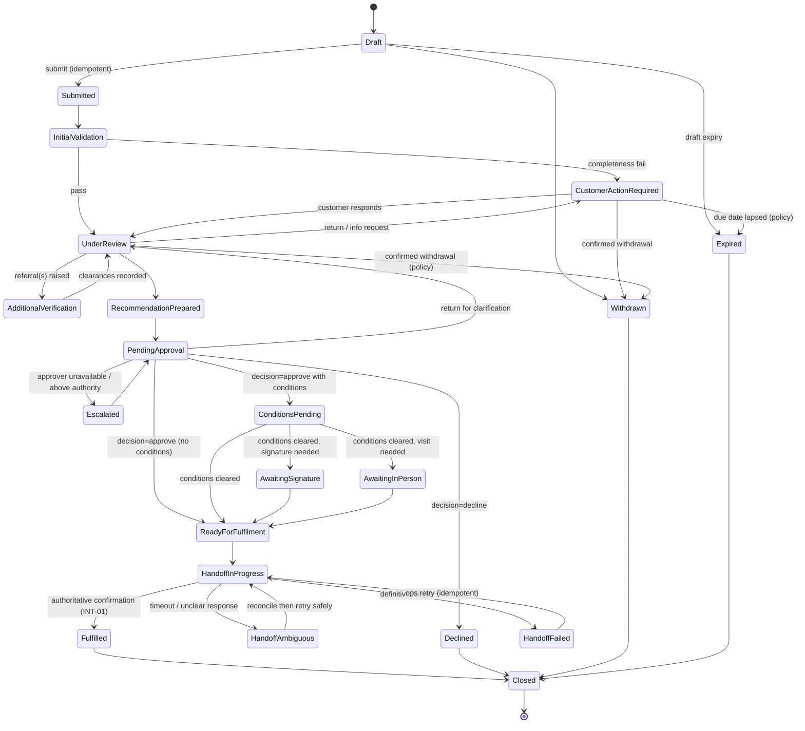
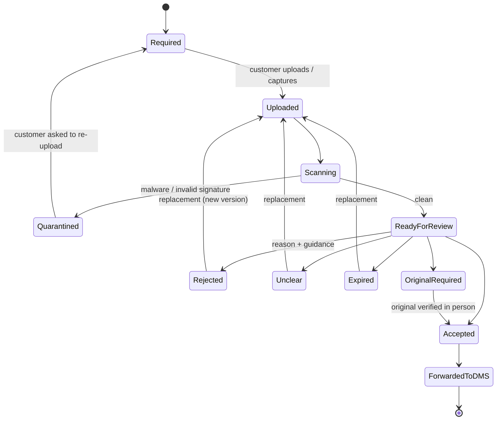
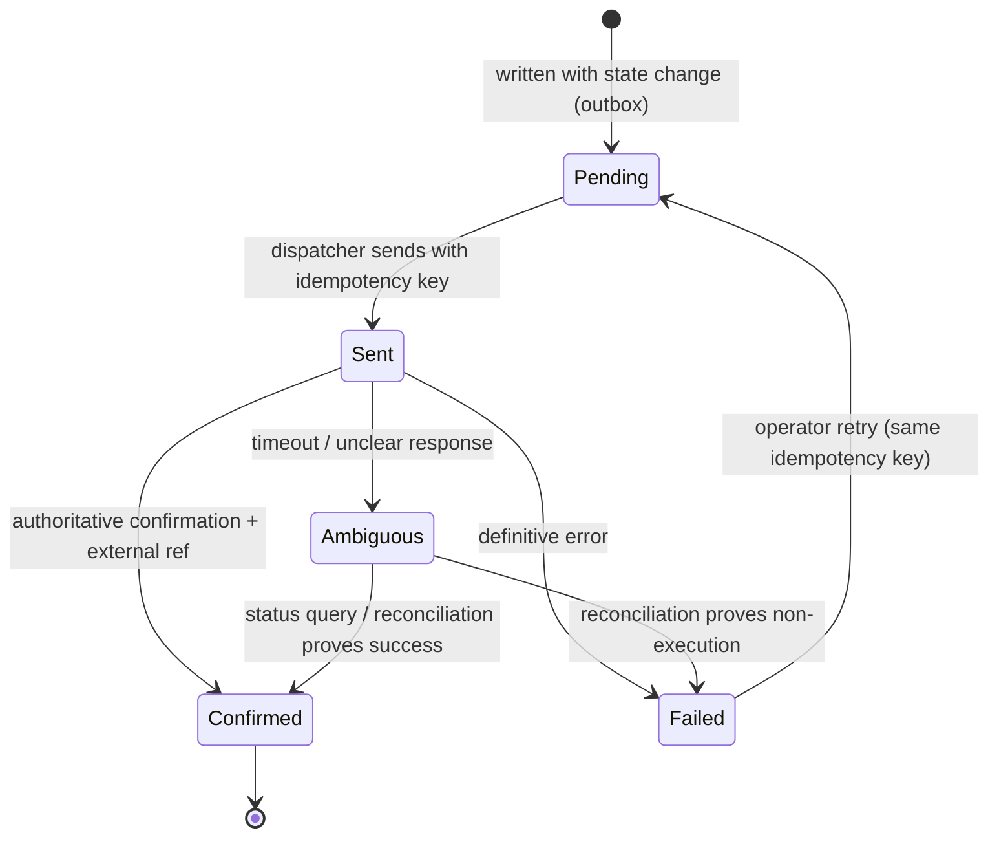

# 04 — Workflow and State Machines

[SOURCE: §4.8–4.10, §6, §9, §11.3] Rules: WFL, APR, DEC, RET, STS, VIS, DOC, INT (see `03`).

## 1. Standard case lifecycle

1. Draft created
2. Customer identity/profile verification
3. Application submitted
4. Automated completeness and format checks
5. Initial service-desk screening
6. Service-specific review
7. Document verification
8. Risk, compliance, legal, credit, treasury or other referrals (as applicable)
9. Clarification / return-to-customer loop
10. Recommendation prepared
11. Approval by authorised human officer(s)
12. Conditions before fulfilment recorded
13. Signature and/or physical verification if required
14. Integration hand-off to the authoritative system
15. Execution confirmation from that system
16. Customer notification
17. Closure and retention under policy

Not every service needs every stage. The engine supports optional, parallel, conditional and repeated stages with explicit, versioned rules (WFL-01).

## 2. Case state machine (internal)

Internal states are bank-configurable; this is the **reference model** shipped as the default template `[PROPOSED]`.

**Guards (examples)**

| Transition | Guard |
|---|---|
| Draft → Submitted | Server validation passes against pinned form version; all required docs present with `scan_status=clean`; required consents recorded; idempotency key unseen or replayed. |
| UnderReview → AdditionalVerification | A referral task created; mandatory clearances recorded as pending. |
| AdditionalVerification → UnderReview | All **mandatory** clearances recorded (WFL-02). |
| PendingApproval → decision | Actor holds sufficient delegated authority at decision time (APR-03); actor ≠ applicant (APR-01); maker ≠ checker if policy (APR-02); rationale present. |
| ReadyForFulfilment | Mandatory conditions cleared; signature and in-person steps complete if required. |
| HandoffInProgress → Fulfilled | `integration_request.status = confirmed` with external reference (INT-01). |
| Declined → anything except Closed | **Forbidden.** Use reconsideration → new linked case (WFL-05). |

Every transition writes `StageExited`/`StageEntered`, an audit event, and a TAT event with `wait_party` (WFL-03, TAT-01).

## 3. Internal → customer-visible status mapping

Controlled dictionary (labels configurable, STS-03). Default mapping `[PROPOSED]`:

| Internal state | Customer-visible status |
|---|---|
| Draft | Draft |
| Submitted, InitialValidation | Submitted → Initial validation |
| CustomerActionRequired | Customer action required / Documents required |
| UnderReview | Under review |
| AdditionalVerification | Additional verification in progress |
| RecommendationPrepared, PendingApproval, Escalated | Pending approval |
| ConditionsPending | Conditions to be completed |
| AwaitingSignature | Awaiting signature |
| AwaitingInPerson | Awaiting mandatory in-person verification |
| ReadyForFulfilment, HandoffInProgress, HandoffAmbiguous, HandoffFailed | Ready for fulfilment *(never reveal ambiguity/failure details)* |
| Fulfilled | Completed |
| Declined | Declined |
| Withdrawn | Withdrawn |
| Expired, Closed | Expired / closed |

Also available: *Decision made* (for decisions the bank chooses to disclose). Never expose fraud flags, SAR indicators, confidential risk grades, deliberations, staff comments or security triggers (STS-02).

## 4. Approval patterns (workflow node configurations)

| Pattern | Notes |
|---|---|
| Sequential | Ordered approvers by authority level |
| Parallel with required sign-offs | e.g. credit + legal + compliance; all mandatory must complete |
| Maker-checker | Different people; enforced by guard |
| Amount- or risk-based | Authority selected from the matrix at runtime |
| Branch + head-office | Two-level chain |
| Committee | Quorum/voting rule per bank; dissent/concern fields where policy permits |
| Compliance/legal veto | Mandatory clearance; veto blocks progression |
| Delegation | During leave; time-limited; within limits |
| Escalation | When approver unavailable or SLA breached |
| Rework after rejection | Returns to named earlier stage |
| Reconsideration | Linked new case, previous decision preserved |
| Conditional approval | Condition list with clearance tracking |
| Exception/deviation | Justification + policy reference |

## 5. Proposal types (bank-configured taxonomy — CRD-02)

New facility/service · renewal/periodic review · enhancement/limit increase · additional facility · restructuring/rescheduling · one-time approval · deviation/policy exception · amendment/rectification · clarification/response to prior approval · notification/acknowledgement of prior approval · pending-document review · pre-disbursement condition clearance · collateral substitution/release · facility cancellation/closure · reconsideration/appeal where permitted.

Abbreviations like DN/CN **must not** be hard-coded. Each bank supplies definitions before configuration.

## 6. Document state machine

Replacement never deletes the prior version (DOC-05). Staff cannot open a file until `clean` (DOC-02).

## 7. Information-request state machine

`Draft (staff composing) → Issued (case → Customer action required) → PartiallyAnswered → Answered (new versions created, queue notified) → Accepted | ReIssued | Lapsed (policy) | Cancelled`.

Each item inside a request has its own status (field/document/question).

## 8. Integration request state machine

Never re-send blindly from `Ambiguous`; resolve first (INT-04).

## 9. Appointment / visit state machine

`NotRequired | Required (reason shown) → Scheduled → Rescheduled* → Attended (completed_by, completed_at) | NoShow → Rescheduled | Cancelled`. On `Attended`, the case resumes at the next step without re-collecting data (VIS-03/04).

## 10. Form/workflow/scorecard version lifecycle

`Draft → Preview/Test → InReview (checker) → Approved → Published (effective_from) → Retired`. Rollback publishes a *new* version equal to a prior one (history is never rewritten). Details in `08`.

## 11. SLA pause/resume rules

1. Pauses are **configured** per stage and reason (e.g. `waiting_customer`, `waiting_third_party`, `system_outage`) — TAT-04.
2. A pause requires a `pause_reason` and records the `wait_party`.
3. Resume is automatic on the matching event (customer response, third-party reply) — not by manual stage edits.
4. Business calendars/holidays are per institution `[BANK-DECIDES]`.
5. Manually moving a case between stages is not permitted outside the engine's allowed transitions; any admin override is a privileged, audited, reasoned action.

## 12. Workflow node types

Start · Automated validation · Human task · Document review · Credit review · Compliance review · Legal review · Parallel review · Approval · Customer information request · Wait for customer · Wait for external system · Branch visit/appointment · Signature · System hand-off · Notification · Conditional branch · SLA timer · Escalation · End/closure.

Each node supports: assignment (role/department/branch), authority and thresholds, deadlines and calendars, customer-visible status mapping, retries, error paths.

## 13. Workflow engine test checklist

- Every permitted transition has a positive test; every forbidden one has a negative test.
- Parallel join does not release until all mandatory branches complete.
- Version pinning: publishing a new workflow does not alter in-flight cases.
- Idempotent event handling (duplicate event → no duplicate transition).
- Delegation/reassignment preserves audit continuity.
- SLA pause/resume produces expected TAT facts.
