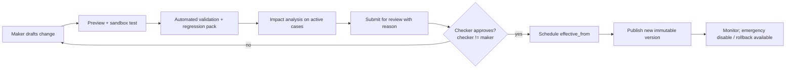

# 08 — Admin Portal and Configuration Governance

[SOURCE: §11, §5.2] The admin portal is a core differentiator **and** the largest source of operational risk. No-code power must be bounded by guardrails (CFG-*).

## 1. Service catalogue builder — fields

Service name, description, category · applicable customer types · product eligibility/availability · supported channels and languages · branch/region/currency applicability · service owner and operational department · required authentication level · required documents and validation rules · expected stages and indicative TAT · fees/disclosures and terms version · remote completion permitted? · visit triggers and mandatory reasons · connected systems and hand-off actions · effective and retirement date · customer-facing help content.

**Required classification:** remote-capable · remote-first with conditional attendance · attendance-required (SVC-01).

## 2. Form builder

### Controls

Text, multiline, number, currency, percentage, date · dropdown, radio, checkbox, multi-select · address, phone, email · file upload and camera capture · repeating table/section · applicant / co-applicant / guarantor / director / beneficial-owner blocks · financial data table · collateral/security schedule · trade document schedule · consent and declaration · signature request component · read-only data from approved systems · calculated fields with visible formula and version · conditional section and branching · help text, validation, required/optional rules.

### Capabilities

Draft · preview · test · publish · retire · versioning and effective dates · field-level labels/types/validation/privacy classification · conditional-logic testing · dependency/conflict checks · **mobile preview** · accessibility validation · translation/localisation · reusable approved field groups · change-approval workflow · rollback to prior version · impact analysis for active applications · migration policy for mid-application changes.

**A published form version is immutable for existing cases** unless migrated through a controlled process (FRM-03).

### Publish blockers (automated)

- Unreachable or contradictory conditional logic
- Required field with no visible path
- Field without privacy classification
- Missing translation for a required locale
- Accessibility check failures (labels, contrast, focus order)
- Calculated field without a documented formula/version
- Regression pack failing

## 3. Workflow builder

Node types: Start · Automated validation · Human task · Document review · Credit review · Compliance review · Legal review · Parallel review · Approval · Customer information request · Wait for customer · Wait for external system · Branch visit/appointment · Signature · System hand-off · Notification · Conditional branch · SLA timer · Escalation · End/closure.

Rules supported: role/department/branch assignment · approval authority · thresholds · deadlines · holiday calendars · customer-visible status mapping · retries · error paths.

### Workflow publish blockers (automated)

- Dead ends / unreachable nodes; missing error paths
- Any path to Approval that skips a mandatory clearance (WFL-02)
- Approval node without authority-matrix binding
- Hand-off node without confirmation-wait (INT-01)
- Missing customer-visible status mapping
- SLA timer without calendar or pause policy
- Guardrail violations (CFG-07): removing mandatory legal controls, bypassing approval authority

## 4. Governance process (maker-checker)

Requirements: least-privilege admin roles · maker-checker for production config · test environment and sandbox · version diff and change reason · effective date and approval evidence · regression pack before publication · rollback and emergency-disable switch · impact review for active cases · immutable configuration audit events · periodic access review · no direct production-DB editing as a normal admin workflow.

### Rollback semantics

Rollback publishes a **new** version equal to a prior one (history is never rewritten). In-flight cases remain pinned to the version they started on unless a controlled migration is approved.

### Emergency disable

A service-level kill switch stops new submissions for a service/version, shows a safe customer message, and does not affect in-flight cases. It is a privileged, audited action requiring second-person confirmation `[PROPOSED]`.

## 5. Mid-flight change policy

| Situation | Behaviour |
|---|---|
| New form version published | New cases use it; existing drafts/cases stay pinned (FRM-03) |
| Customer returned for correction | Correction uses the **original** pinned form version unless a controlled migration was approved |
| Controlled migration | Impact report, mapping of old→new fields, approval, audit, customer notice if material |
| Workflow change | In-flight instances stay pinned (WFL-07) |

## 6. User, role and reporting-line management

Administrators can: create/disable users through approved identity lifecycle · assign roles and attributes · set branch/department/portfolio/case scope · assign manager/reporting line · configure delegation periods and backup approvers · set approval limits from a controlled authority matrix · review last login and privileged activity · initiate access recertification · revoke access immediately.

- High-risk role assignment requires a second authorised approver (APR-11).
- Integrate with bank identity providers/staff directories; do **not** maintain a conflicting source of employee identity.
- Authority matrix changes are versioned configuration under maker-checker.

## 7. Standard roles (configurable)

Customer service / service desk · branch operations · account opening/KYC · relationship manager · credit analyst/officer · credit administration · collateral/valuation · trade finance · treasury · compliance/AML · legal · risk · finance/fee · branch manager · credit approver (delegated authority) · department head · internal audit (read-only) · senior management viewer · system administrator · service/form designer · workflow administrator · integration operations administrator · security administrator.

Access = role **and** attributes (branch, department, portfolio, product, legal entity, case sensitivity, amount, assignment). A role name alone must never grant access to every case (SEC-12).

## 8. Admin UX rules

- Show the exact diff and impact before publish.
- Never offer "edit live" on a published object; offer "create new version".
- Surface guardrail violations inline with the rule ID and plain-language reason.
- Every admin action shows who/when/why in the history.
- Dangerous actions (emergency disable, privileged access, rollback) require re-authentication and confirmation.
