# 18 — Roadmap and Phase Gates

[SOURCE: §19, §22] A phase is **not complete** because code is written. It must pass functional tests, security review, UAT and approval by the designated product owner and bank stakeholders.

## Overview

```mermaid
gantt
  title BBJP phases (relative sequence; durations set per team/bank)
  dateFormat  X
  axisFormat %s
  section Foundation
  P0 Discovery & regulatory mapping     :p0, 0, 2
  P1 Architecture, security, design sys :p1, after p0, 2
  section Core product
  P2 Identity, profile, catalogue       :p2, after p1, 2
  P3 Form builder + document intake     :p3, after p2, 3
  P4 Workflow, staff portal, tracking   :p4, after p3, 3
  section Prove value
  P5 First live service pilot           :p5, after p4, 3
  section Expand
  P6 Credit orchestration               :p6, after p5, 4
  P7 Trade, securities-backed, complex  :p7, after p6, 4
  P8 TAT analytics + exec dashboards    :p8, after p5, 3
  P9 Enterprise hardening + rollout     :p9, after p7, 3
  P10 Controlled AI                     :p10, after p9, 3
```

*(Bar lengths are relative placeholders; set real estimates with the design-partner bank.)* Phase 8 can begin once the event model from Phase 4 has real data.

---

## Phase 0 — Discovery, product validation, regulatory mapping
**Objective:** Prove a real bank has a problem worth paying to solve.
**Activities:** interview ops, digital banking, credit, compliance, legal, IT, infosec, branch managers, senior management · map current journeys for 1–2 candidate services · identify repeated visits, rework, missing documents, manual hand-offs, existing system capabilities · define system-of-record ownership and integration feasibility · product-by-product legal/policy question register · identify design-partner bank and executive sponsor · agree baseline metrics and pilot success criteria · pricing/procurement hypotheses.
**Deliverables:** product vision and scope · personas and service blueprints · current/future journey maps · PRD · risk and dependency register · integration inventory · data classification and privacy assessment draft · initial architecture decision record · pilot proposal and business case.
**Exit gate:** named bank sponsor · specific workflow problem evidenced by data/observation · credible data-access/integration path · security/procurement stakeholders identified · no unresolved fatal legal/technical blocker.

## Phase 1 — Architecture, security foundation, design system
**Objective:** Establish a safe foundation before implementing sensitive workflows.
**Activities:** threat model and data-flow diagrams · identity, roles, tenant model, access control · encryption, secrets, logging, audit, backup design · core entities, event model, API standards · responsive design system and accessibility rules · CI/CD, code review, automated tests, environments · secure document-upload architecture · configuration versioning and maker-checker governance · workflow-engine spike (ADR-018).
**Deliverables:** architecture and security design · data model and API contract · threat model · UI design system · CI/CD pipeline · test strategy · deployment and rollback plan.
**Exit gate:** architecture and security review approved · access-control model tested · no critical issue in baseline security testing · approved environment and deployment approach.

## Phase 2 — Identity, customer profile, service catalogue
**Objective:** Customers create a secure profile and discover services.
**Activities:** email/mobile OTP · profile and contact management · existing-customer linking (integration or controlled pilot flow) · authentication and recovery · consent/privacy notice capture · service catalogue · profile completion/verification status · responsive customer dashboard · basic staff customer lookup under permissions.
**Deliverables:** customer profile · secure authentication · service catalogue · customer dashboard · existing-customer linking prototype · audit and consent records.
**Tests:** OTP abuse/rate limits · enumeration resistance · customer data isolation · existing-customer matching/duplicates · session and recovery security · mobile usability and accessibility.
**Exit gate:** no cross-customer data exposure · security tests passed · bank approves identity-linking flow · customer can create and resume profile on mobile and desktop.

## Phase 3 — No-code form builder and document intake
**Objective:** Bank configures forms and collects evidence without code per service.
**Activities:** dynamic form renderer · drag-and-drop builder · conditional logic/validation · save/resume · camera/file upload · secure scanning and storage · document requirement catalogue · review outcomes · form versioning and publication workflow · customer correction loop.
**Deliverables:** form designer · mobile-first customer form experience · document upload and review service · version history · customer resubmission flow.
**Tests:** large/unsupported/malicious files · network interruption/resume · duplicate submissions · form-version change during active cases · file access control · correction and version audit · accessibility and mobile camera support.
**Exit gate:** admin creates/publishes a test service form without code · documents not publicly accessible · customer corrects a returned form without losing history · security and UAT approval.

## Phase 4 — Workflow engine, staff portal, status tracking
**Objective:** Process requests end-to-end with controlled human tasks and customer-visible progress.
**Activities:** workflow designer and runtime · staff queues, assignment/reassignment · department/role routing · parallel and sequential reviews · request-more-information loop · customer status mapping · approval, return, decline, escalation, closure · notifications · audit events and timeline · SLA policy and stage timestamps.
**Deliverables:** staff portal · workflow builder · customer tracking timeline · notification centre · audit history · basic TAT dashboard.
**Tests:** unauthorised approval attempts · maker-checker separation · reassignment/delegation · customer status privacy · parallel dependencies · retry/duplicate events · SLA pause/resume correctness.
**Exit gate:** a case can be submitted, reviewed, returned, corrected, approved/declined and closed end-to-end · every transition has actor, timestamp, reason · customer sees only approved status info · ops and compliance sign off.

## Phase 5 — First live service pilot
**Objective:** Prove value with a bounded, low-complexity service before complex credit products.
**Recommended candidates:** account/service certificate request · KYC update · cheque book/card service request · a deposit-related request where system and rules permit · bounded personal-loan enquiry/application intake without automated approval. Choose by partner bank's biggest pain and available integration — not convenience alone.
**Activities:** configure service-specific form and workflow · connect to one bank system or controlled hand-off · staff training and customer support · UAT · establish baseline and pilot metrics · weekly issue/feedback monitoring.
**Deliverables:** pilot service in controlled production · training materials · incident and support runbook · pilot outcome report.
**Exit gate:** no unresolved critical security defect · successful case completion and reliable audit trail · bank accepts the operational process · measured improvement in agreed metrics or documented decision to revise the product.

## Phase 6 — Credit application orchestration
**Objective:** Full digital journey for selected lending products.
**Activities:** product-specific loan forms and dynamic checklists · proposal types (new, renewal, enhancement, one-time, exception, rectification) · co-applicant/guarantor and business ownership structures · credit reviewer workspace · financial inputs and deterministic ratio calculations · scorecard versioning and explainability · collateral and condition tracking · approval-authority matrix integration · CIB/bureau and other approved checks via authorised systems · conditional approval and pre-disbursement condition tracking · hand-off to LMS/CBS with confirmed status.
**Deliverables:** credit proposal workspace · product checklists · scorecard configuration · credit approval workflow · LMS/CBS integration · credit portfolio dashboard.
**Exit gate:** credit policy owner approves every checklist and scorecard · calculations independently tested · no automatic final approval/decline · approval authority and maker-checker verified · integration hand-off and failure recovery tested.

## Phase 7 — Trade finance, securities-backed lending, complex products
**Objective:** Workflows with higher legal, collateral and document complexity.
**Activities:** LC and guarantee request workflows · trade document checklist and discrepancy loop · amendment/extension · margin lending and loan against shares · eligible-security configuration and valuation source · haircut, exposure, concentration, margin-call calculations · pledge/collateral status integrations · original-document and in-person triggers · product-specific legal/compliance approvals.
**Deliverables:** trade finance request module · securities-backed lending module · controlled collateral workflow · product-specific dashboards.
**Exit gate:** legal, credit, compliance, treasury/operations and system owners approve workflows · all calculations validated · no unauthorised collateral or transaction action possible · external-system and original-document exceptions tested.

## Phase 8 — TAT analytics, executive dashboards, bottleneck intelligence
**Objective:** Make operational performance and delays visible across the bank.
**Activities:** event-based TAT engine · business-hours and holiday calendars · waiting-time attribution · pending-document reports · department/product/branch/portfolio dashboards · SLA breach and bottleneck analysis · executive dashboard and controlled export · metric dictionary, lineage, freshness · data-quality monitoring.
**Exit gate:** metrics reconcile to test cases and source records · customer-wait vs bank-processing distinguished · dashboard permissions tested · senior management validates metrics and definitions.

## Phase 9 — Enterprise hardening and bank-wide rollout
**Objective:** Make the product operationally supportable across more services and departments.
**Activities:** SSO and enterprise identity integration · production API/event integrations · performance and resilience testing · DR and restore testing · penetration testing and remediation · business continuity · vendor-risk and outsourcing documentation · operational support, SLAs, incident response · staff training, change management, phased rollout · catalogue governance and periodic access review.
**Exit gate:** bank security, IT ops, risk, compliance, legal and business owners approve production · recovery and incident processes tested · monitoring and support coverage in place · rollout and rollback plan approved.

## Phase 10 — Controlled AI assistance
**Objective:** Reduce manual reading and data prep without weakening accountability.
**Activities:** OCR/extraction with confidence and source links · application summary and discrepancy detection · draft missing-information requests · policy search with citation · AI-assisted report commentary · model evaluation, prompt-injection tests, human correction logging · approved model hosting and data-processing controls.
**Exit gate:** accuracy measured on representative authorised data · material facts trace to sources · low-confidence cases route to humans · no AI-only final credit/compliance/legal decisions · bank AI-governance approval and rollback plan.

---

## Go / no-go rule

Do **not** commit to a full build until at least one bank: validates the workflow gap, names a sponsor, identifies an integration path, approves a pilot scope and agrees measurable success criteria.
